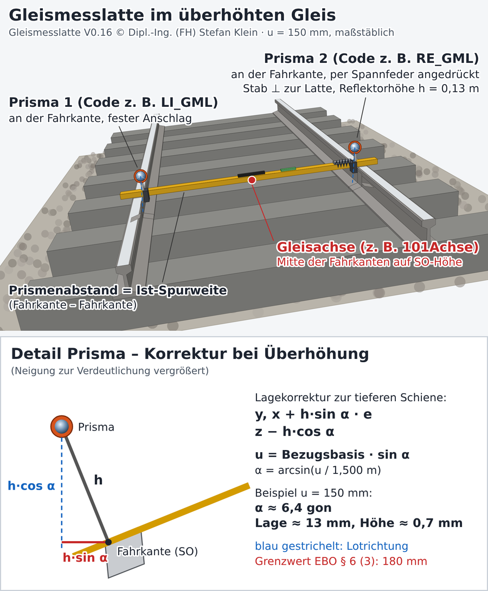
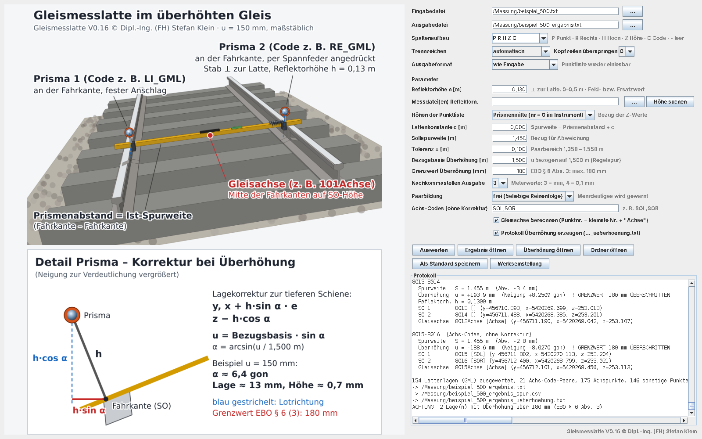
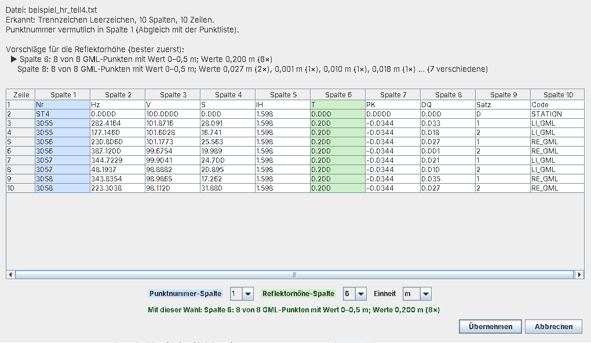

# Gleismesslatte

**Auswertung von Tachymetermessungen mit einer Gleismesslatte – Spurweite, Überhöhung und Gleisachse**

© Dipl.-Ing. (FH) Stefan Klein · MIT-Lizenz · Java 17 · Windows / Linux / macOS



Eine Gleismesslatte trägt zwei lotrecht zur Latte montierte Prismen. Ein Prisma liegt mit
einem festen Anschlag an der inneren Fahrkante der einen Schiene an, das andere wird über eine
Spannfeder an die Fahrkante der anderen Schiene gedrückt. Der Prismenabstand entspricht damit
der Ist-Spurweite.

In überhöhten Gleisen steht die Latte schräg. Die Prismen sitzen um die Reflektorhöhe *h*
senkrecht zur Latte über der Schiene und damit seitlich versetzt zum Messpunkt. Die
gemessenen Koordinaten (Rechtswert, Hochwert, Höhe) sind deshalb verfälscht. Das Programm rechnet
diese Fehlstellung heraus und bestimmt je Lattenlage

- die **korrigierten Fahrkantenpunkte** auf Schienenoberkante (SO),
- die **Ist-Spurweite** und ihre Abweichung von der Sollspurweite,
- die **Überhöhung** mit Prüfung gegen den Grenzwert nach EBO,
- den **Gleisachspunkt** (Gleismitte),
- optional ein **Überhöhungsprotokoll** mit Rampenneigung.

---

## Inhalt

- [Funktionen](#funktionen)
- [Download und Start](#download-und-start)
- [Bedienung](#bedienung)
- [Eingabeformat](#eingabeformat)
- [Parameter](#parameter)
- [Ergebnisdateien](#ergebnisdateien)
- [Reflektorhöhe aus Messdateien](#reflektorhöhe-aus-messdateien)
- [Rechenweg](#rechenweg)
- [Beispiele](#beispiele)
- [Aus dem Quellcode bauen](#aus-dem-quellcode-bauen)
- [Projektaufbau](#projektaufbau)
- [Lizenz und Haftungsausschluss](#lizenz-und-haftungsausschluss)
- [English summary](#english-summary)

---

## Funktionen

- **Erkennung über den Code:** Punkte mit **„GML“ als Präfix oder Suffix** im Code sind
  Lattenprismen, z. B. `GML`, `GML01`, `LI_GML`, `GML-RE`, `L.GML`. Nach der Korrektur wird
  die GML-Kennung aus dem Code gelöscht (`LI_GML` → `LI`, `GML` → leer).
- **Paarbildung über die Spurweite:** Zwei Punkte bilden nur dann ein Paar, wenn ihr Abstand
  in *Sollspurweite ± Toleranz* liegt (Standard 1,458 m ± 0,10 m).
  - `aufeinanderfolgend`: Die beiden Punkte stehen direkt hintereinander (Standard).
  - `frei`: beliebige Reihenfolge, z. B. erst alle linken, dann alle rechten Schienenpunkte.
- **Achs-Codes ohne Korrektur:** Mit einem Gleismessstab werden die Fahrkanten direkt
  aufgemessen. Diese Punkte haben keinen GML-Code. Für frei wählbare Codes wie `SOL,SOR` wird
  die Gleisachse berechnet, die Punkte selbst bleiben aber unverändert.
- **Gleisachse optional:** Der Achspunkt erhält die **kleinste Punktnummer des Paares +
  „Achse“**, z. B. `101Achse`.
- **Grenzwert Überhöhung:** Die Prüfung erfolgt nach **EBO § 6 Abs. 3** mit höchstens 180 mm
  (einstellbar). Eine Überschreitung erscheint als Warnung, in der Spur-CSV und im Protokoll.
- **Flexible Eingabe:**
  - CSV oder durch Leerzeichen/Tab getrennter Text
  - Spaltenfolge einstellbar (Standard `P R H Z C`)
  - 0–5 Kopfzeilen
  - Dezimalpunkt oder Dezimalkomma
- **Ausgabe im Format der Eingabe:** Die Ergebnisdatei hat denselben Aufbau wie die Eingabe
  und lässt sich wieder einlesen.
- **Reflektorhöhe je Punkt aus Rohdaten:**
  - Leica GSI, Trimble JobXML, LandXML und beliebige Text-Tabellen
  - automatische Spaltenerkennung mit Vorschlagsfenster
  - Wertebereich 0–0,5 m
- **Ausgabe mit 3 oder 4 Nachkommastellen.**
- **Programmfenster mit Bild:** Alle Parameter sind einstellbar, Drag & Drop wird
  unterstützt. Alle Eingaben werden gespeichert und beim nächsten Start wieder geladen.
- **Konsole / Stapelverarbeitung:** Alle Parameter lassen sich als `name=wert` übergeben.
- **Keine externen Bibliotheken:** Es wird nur das JDK benötigt.



---

## Download und Start

### Windows (fertige Programme)

Unter [**Releases**](../../releases) liegt `Gleismesslatte_V0.xx_Windows.zip`:

| Datei | Zweck |
|---|---|
| `Gleismesslatte.exe` | Programmfenster |
| `GleismesslatteKonsole.exe` | Eingabeaufforderung / Stapelverarbeitung |
| `Gleismesslatte.jar` | das eigentliche Programm |
| `exe_bauen.bat` | baut eine Version **mit eingebauter Java-Laufzeit** (ohne Java-Installation lauffähig) |
| `beispiel_*` | Beispieldaten |

Für die beiden .exe-Dateien wird **Java 17 oder neuer** benötigt, z. B.
[Eclipse Temurin](https://adoptium.net/). Der Starter sucht die Laufzeit an folgenden Stellen:

- `JAVA_HOME`
- `PATH`
- den üblichen Installationsordnern

Alternativ führt man auf einem PC mit JDK einmal `exe_bauen.bat` aus und gibt danach den
ganzen Ordner `dist\Gleismesslatte\` weiter.

### Alle Betriebssysteme

```sh
java -jar Gleismesslatte.jar                         # Programmfenster
java -jar Gleismesslatte.jar messung.txt             # Konsole, Ergebnis: messung_ergebnis.txt
java -jar Gleismesslatte.jar messung.txt ergebnis.txt h=0,13 achscodes=SOL,SOR paarbildung=frei
```

---

## Bedienung

1. Die Messdatei öffnen. Das geht über das Feld „Eingabedatei“ oder per Drag & Drop ins
   Fenster bzw. auf die .exe.
2. Die Spaltenfolge, das Trennzeichen und die Anzahl der Kopfzeilen zur Datei passend
   einstellen.
3. Die Reflektorhöhe *h* eintragen oder die Messdateien mit der Reflektorhöhe wählen
   (siehe [unten](#reflektorhöhe-aus-messdateien)).
4. **Auswerten** klicken. Warnungen und die Zusammenfassung erscheinen im Meldungsfeld, die
   Ergebnisdateien lassen sich direkt öffnen.

Alle Eingaben werden in `%APPDATA%\Gleismesslatte\sitzung.properties` (Windows) bzw.
`~/.gleismesslatte/sitzung.properties` gespeichert. **„Als Standard speichern“** schreibt die
Werte zusätzlich in `gleismesslatte.properties` neben dem Programm. **„Werkseinstellung“**
setzt alle Werte auf die Standardwerte zurück.

---

## Eingabeformat

Standard-Spaltenfolge: **Punktnummer, Rechtswert, Hochwert, Höhe, Code** (`P R H Z C`):

```text
101  456123.412  5420001.118  254.731  GML
102  456123.398  5420002.574  254.739  GML
103  456123.917  5420010.002  254.668  MAST
```

| Kürzel | Bedeutung |
|---|---|
| `P` | Punktnummer |
| `R` | Rechtswert (y / Ost) |
| `H` | Hochwert (x / Nord) |
| `Z` | Höhe |
| `C` | Code (darf beim Leerzeichen-Format Leerzeichen enthalten, wenn er in der letzten Spalte steht) |
| `-` | Spalte überspringen |

Zeilen, die mit `#` beginnen, und Leerzeilen werden ignoriert. Unvollständige Zeilen werden mit
einer Warnung übersprungen. Dateien in UTF-8 und ANSI (Windows-1252) werden erkannt.

---

## Parameter

Die Parameter lassen sich im Fenster, in `gleismesslatte.properties` oder als Argument
`name=wert` in der Konsole einstellen.

| Name | Standard | Bedeutung |
|---|---|---|
| `h` | `0.130` | Reflektorhöhe über SO, senkrecht zur Latte [m], 0–0,5 m |
| `c` | `0.000` | Lattenkonstante: Spurweite = Prismenabstand + c [m]. Die Prismen liegen an der Fahrkante an, daher ist c = 0 der Normalfall. |
| `sollspurweite` | `1.458` | Sollspurweite [m]: Bezug der Abweichung und Mitte des Paarbereichs |
| `toleranz` | `0.100` | ± Toleranz der Paarbildung [m] |
| `bezugsbasis` | `1.500` | Bezugsbasis der Überhöhung [m] (Regelspur: Abstand der Schienenkopfmitten) |
| `maxueberhoehung` | `180` | Grenzwert der Überhöhung [mm] (EBO § 6 Abs. 3) |
| `achse` | `ja` | Gleisachspunkt berechnen |
| `nachkommastellen` | `3` | 3 oder 4 Nachkommastellen in der Ausgabe |
| `ueberhoehungsprotokoll` | `ja` | zusätzliches Protokoll `…_ueberhoehung.txt` |
| `paarbildung` | `folge` | `folge` (aufeinanderfolgend) oder `frei` |
| `achscodes` | leer | Codes ohne Korrektur, z. B. `SOL,SOR` |
| `aufbau` | `P R H Z C` | Spaltenfolge der Eingabe |
| `trennzeichen` | `auto` | `auto`, `semikolon` oder `leerzeichen` |
| `kopfzeilen` | `0` | 0–5 übersprungene Kopfzeilen |
| `ausgabeformat` | `eingabe` | `eingabe` (wie Eingabe) oder `status` (CSV mit Statusspalte) |
| `hdateien` | leer | Messdateien mit Reflektorhöhe je Punkt, mit `;` getrennt |
| `hbezug` | `prisma` | `prisma` (Höhen = Prismenmitte) oder `reduziert` (im Instrument um hr reduziert) |

---

## Ergebnisdateien

| Datei | Inhalt |
|---|---|
| `<name>_ergebnis.<endung>` | Punktliste im Format der Eingabe: GML-Punkte auf SO korrigiert (ohne GML im Code), Achspunkte `…Achse`, alle anderen Punkte unverändert |
| `<name>_ergebnis_spur.csv` | je Lattenlage: Spurweite, Abweichung, Überhöhung, Grenzwertprüfung, Gleisachse, Reflektorhöhe |
| `<name>_ergebnis_ueberhoehung.txt` | Protokoll: Station, Querneigung, Überhöhung links/rechts, Rampe in mm/m und 1:n, Zusammenfassung |

---

## Reflektorhöhe aus Messdateien

Wird die Latte mit unterschiedlichen Reflektorhöhen gemessen, kann das Programm die Höhe je
Punkt aus den Rohdaten lesen. Eine oder mehrere Dateien lassen sich auch gemischt verwenden.

| Format | Quelle der Höhe |
|---|---|
| Leica GSI-8/16 | Wort `87` |
| Trimble JobXML (`.jxl`) | `TargetHeight` |
| LandXML / XML | `targetHeight` u. ä. |
| Text-Tabellen | automatische Spaltenanalyse |

**Spaltenanalyse bei Text-Tabellen:** Die Tabellen brauchen keine festen Spaltennamen.
Das Programm wählt die Spalten so:

- Punktspalte: die Spalte mit den meisten Treffern in der Punktliste
- Höhenspalte: die Spalte, in der die GML-Punkte plausible Werte von 0–0,5 m haben (auch in mm)
  und nur wenige verschiedene Werte auftreten

Über **„Höhe suchen“** öffnet sich ein Fenster mit Tabellenvorschau, Vorschlag und Begründung.
Dort lässt sich die Spalte übernehmen oder ändern. Die Wahl wird je Datei gespeichert.



> **Wichtig – Höhenbezug:** War die Reflektorhöhe im Instrument eingetragen, sind die
> exportierten Höhen bereits lotrecht um hr reduziert. Dann muss **„Höhen der Punktliste = um
> Reflektorhöhe lotrecht reduziert“** (`hbezug=reduziert`) gewählt werden. Andernfalls entsteht
> ein Höhenfehler in der Größe von hr. Das Programm warnt, wenn die Messdateien hr > 0
> enthalten und „Prismenmitte“ gewählt ist.

---

## Rechenweg

Gegeben sind die beiden Prismenpunkte P₁ und P₂ einer Lattenlage. Daraus folgen:

| Größe | Formel |
|---|---|
| Prismenabstand (schräg) | s = ‖P₂ − P₁‖ |
| Querneigung der Latte | sin α = Δz / s |
| horizontaler Einheitsvektor P₁ → P₂ | e |
| Normale der Latte (nach oben) | n = (−sin α · e, cos α) |
| Fahrkantenpunkt auf SO | Fᵢ = Pᵢ − h · n |
| Spurweite | ‖F₂ − F₁‖ + c |
| Überhöhung | u = Bezugsbasis · sin α |
| Gleisachse | A = (F₁ + F₂) / 2 |

Bei `hbezug=reduziert` wird vor der Korrektur zuerst hr lotrecht wieder addiert. Für Punkte mit
Achs-Code entfällt die Korrektur: Sie liegen bereits auf der Fahrkante.

---

## Beispiele

Im Ordner [`beispiele/`](beispiele) liegen folgende Beispieldaten:

| Datei | Inhalt |
|---|---|
| `beispiel_500.txt`, `beispiel_500_csv.csv` | 500 simulierte Punkte mit allen Varianten: Gerade, Übergangsbögen, Bögen links/rechts, Codevarianten, freie Reihenfolge, Achs-Codes, Grenzwertfälle, fehlerhafte Zeilen. Beschreibung in [`beispiel_500_LIESMICH.txt`](beispiele/beispiel_500_LIESMICH.txt), Sollwerte in `beispiel_500_soll.csv` |
| `beispiel_hr_punkte.txt` + `beispiel_hr_teil1.gsi` / `teil2.jxl` / `teil3.xml` / `teil4.txt` | wechselnde Reflektorhöhen aus vier Rohdatenformaten, Höhen um hr reduziert, Sollwerte in `beispiel_hr_soll.csv` |
| `beispiel_eingabe.csv`, `beispiel_frei.csv`, `beispiel_achscodes.csv`, `beispiel_rampe.csv` | kleine Einzelbeispiele (Semikolon, Aufbau `P R H Z C`) |

Die Beispieldaten wurden mit den Python-Skripten in `doc/` erzeugt und lassen sich damit
nachvollziehen.

---

## Aus dem Quellcode bauen

Voraussetzung: **JDK 17 oder neuer**. Externe Bibliotheken werden nicht benötigt.

### Eclipse

1. *File → Import → General → Existing Projects into Workspace*, dann den Repository-Ordner
   wählen. Alternativ *File → Import → Git → Projects from Git* mit der Repository-URL.
2. Das Projekt ist auf JavaSE-17 eingestellt. Quellordner sind `src` und `test`.
3. Fertige Startkonfigurationen liegen in `eclipse/` und erscheinen unter *Run → Run
   Configurations*:
   - **Gleismesslatte (Fenster)**
   - **Gleismesslatte Beispiel 500 (Konsole)**
   - **Gleismesslatte Beispiel Reflektorhoehe (Konsole)**
   - **Gleismesslatte Selbsttest**

### Kommandozeile

```sh
./bauen.sh        # Linux / macOS
bauen.bat         # Windows
```

Das Skript übersetzt die Quellen und führt den **Selbsttest** aus. Dabei werden Rechenkern,
Codierung, Eingabeformat, Spaltenanalyse und beide Beispiele gegen ihre Sollwerte geprüft.
Anschließend wird `dist/Gleismesslatte.jar` erzeugt.

### Windows-Programme

| Weg | Ergebnis |
|---|---|
| `windows\exe_bauen.bat` | eigenständige Version mit eingebauter Java-Laufzeit (jpackage) |
| `windows/paket_bauen.sh` | Release-Zip mit den Go-Startern aus `launcher/` (benötigt Go 1.22+) |

Das Programmsymbol und die Dateieigenschaften der Starter stecken in
`launcher/rsrc_windows_amd64.syso`. Diese Datei wird mit `launcher/syso_erzeugen.py` erzeugt.

### GitHub Actions

Der Workflow `.github/workflows/bauen.yml` baut bei jedem Push und führt den Selbsttest aus.
Gibt es für die Versionsnummer in `Version.java` noch kein Release, legt er beim Push auf
`main` automatisch eines an (Tag `v0.xx`) und hängt Windows-Zip und `.jar` an. Für ein neues
Release genügt es also, die Versionsnummer zu erhöhen und hochzuladen.

### Versionsnummer

Das Format ist **V0.xx**. Bei jeder Änderung steigt die Nummer um 0,01. Sie steht in
`src/de/gleismessung/Version.java`. Die Historie steht im [CHANGELOG](CHANGELOG.md).

---

## Projektaufbau

```text
src/de/gleismessung/      Quellcode (Rechenkern, Ein-/Ausgabe, Fenster)
  bild/                   Bilder und Programmsymbol (im .jar enthalten)
test/de/gleismessung/     Selbsttest (ohne Testbibliothek)
beispiele/                Beispieldaten mit Sollwerten
doc/                      Quellgrafiken (SVG), Bildgenerator, Beispielgeneratoren
eclipse/                  Eclipse-Startkonfigurationen
launcher/                 Go-Starter für Windows (.exe)
windows/                  Windows-Paket: LIESMICH, exe_bauen.bat, Paketskript
gleismesslatte.properties Standardparameter
```

---

## Lizenz und Haftungsausschluss

Veröffentlicht unter der [MIT-Lizenz](LICENSE). Die Nutzung, Änderung und Weitergabe ist auch
kommerziell erlaubt, wenn der Urhebervermerk erhalten bleibt.

**Haftungsausschluss:** Das Programm wird ohne jede Gewährleistung bereitgestellt. Es ist
**kein zugelassenes Prüf- oder Abnahmemittel**. Die Ergebnisse sind vor der Verwendung
fachkundig zu prüfen. Maßgeblich sind die geltenden Regelwerke, z. B. die EBO und die
Richtlinien des jeweiligen Infrastrukturbetreibers. Die Lattenkonstante und die Reflektorhöhe
sind für jede Latte durch Kalibrierung zu bestimmen.

Fehlermeldungen und Verbesserungsvorschläge sind über
[Issues](../../issues) willkommen.

---

## English summary

**Gleismesslatte** evaluates total-station measurements of a *track gauge lath* carrying two
prisms that rest against the inner running edges of the rails. On canted track the lath is
tilted, so the prism coordinates are offset by the reflector height perpendicular to the lath.
The program removes this offset and computes, for each lath position:

- the corrected rail-edge points
- the actual track gauge
- the cant, checked against the 180 mm limit of the German EBO
- the track centre-line point

**How points are handled:**

- Prism points are recognised by the prefix or suffix `GML` in the point code.
- Additional codes (e.g. `SOL,SOR`) can be paired without correction.

**Input and parameters:**

- The input is CSV or whitespace-separated text with a configurable column layout.
- Reflector heights can be read per point from Leica GSI, Trimble JobXML, LandXML or arbitrary
  text tables.

**Building:** Pure Java 17 with no dependencies. Run `./bauen.sh` (or import the project into
Eclipse); it builds the program and runs the built-in self-test. The user interface is in
German. MIT licensed; no warranty, and it is not an approved inspection tool.
